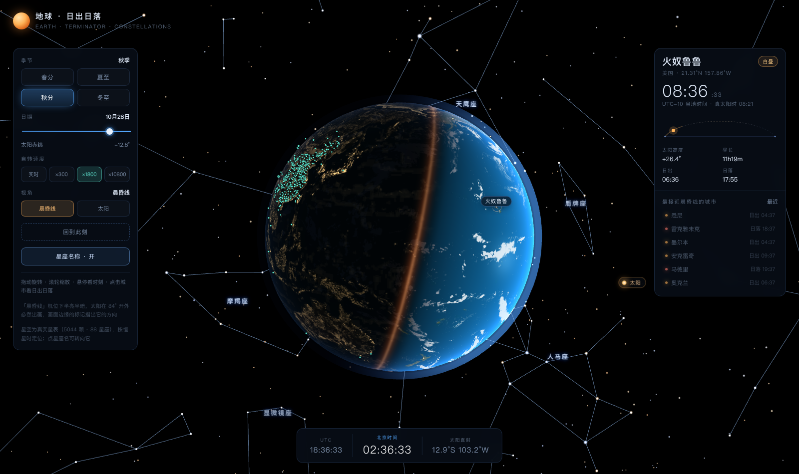

# 地球 · 日出日落 · 星座

一个可交互的 3D 地球：实时晨昏线、太阳真实方位、按季节与时刻定位的真实星空。
纯前端，无后端、无外部请求，构建产物是**单个 HTML 文件**，双击即可打开。



---

## 快速开始

```bash
npm install

npm run dev      # 开发服务器 http://127.0.0.1:5173 （热更新）
npm run check    # 验收：lint + 单元测试 + 打包，一条命令跑完
npm run build    # 只打包 → dist/index.html —— 单文件，贴图全部内联
```

需要 Node 20+（`.nvmrc` 已锁 22）。`npm run verify` 额外需要本机装有 Chrome（走 CDP 截图/取数，不依赖 Playwright）。

**不想装 Node 也行**：直接用浏览器打开 `dist/index.html`。

---

## 功能

| 模块 | 说明 |
| --- | --- |
| 地球 | 昼夜双贴图按 `N·L` 混合，晨昏带宽过渡 + 暖色散射，海洋镜面高光，边缘大气辉光，独立云层 |
| 太阳 | 按 NOAA 简化算法算赤纬与时差，世界坐标里**只随赤纬移动**，不做任何「为了看得见」的补偿 |
| 视角 | 两档真实机位：**晨昏线**（默认，太阳出画，画面边缘有方位标记）/ **太阳**（贴着夜半球，太阳压在地球边缘外） |
| 晨昏线 | 任意时刻的真实直射点；「此刻正在日出/日落」的城市列表按距地平线远近排序 |
| 城市 | 中国 335 个地级市 + 50 个主要国际城市，点云随地球自转，悬停看当地时间，点击看日出日落与昼长 |
| 星空 | 真实星表 5044 颗（Yale 亮星，6 等以上），按 B−V 色指数上色 |
| 星座 | 88 星座星间连线（大圆细分）+ 骨架星 + **中文名称**，按恒星时定位，随季节/时刻自动换季 |
| 交互 | 拖拽旋转、滚轮缩放、点星座名转向它、星座名/连线开关、四季快切、日期滑块、4 档自转速度 |

---

## 工程化

### 命令矩阵

| 命令 | 作用 | 额外依赖 |
| --- | --- | --- |
| `npm run dev` | 开发服务器，热更新 | — |
| `npm run build` | 出单文件 `dist/index.html` | — |
| `npm test` | 55 组单元测试，约 150ms | 无（`node:test` 内置） |
| `npm run test:watch` | 单元测试监听模式 | — |
| `npm run lint` / `lint:fix` | ESLint 9 扁平配置 | — |
| `npm run check` | lint → test → build 顺序跑一遍 | — |
| `npm run verify` | 跨语言对账：Python 复算星空位置 | Chrome |
| `npm run gen:cities` / `gen:sky` / `gen:all` | 重新生成 `src/data/*` | Python 3 |

### 测试守的是什么

没有引入任何测试框架，用 Node 内置的 `node:test`，`npm install` 完就能跑，也不会因为测试工具升级而挂掉。

| 文件 | 守住的东西 |
| --- | --- |
| `tests/math.test.js` | 坐标约定（经度 0 → `+X`、90°E → `−Z`）、角度归一、大圆插值、`rotation.y = −经度` 的自洽性。这些写错会让整个场景镜像，肉眼几乎查不出来 |
| `tests/solar.test.js` | 四节气赤纬、时差极值范围、直射点每小时西移 15°、极昼极夜、南北半球昼长互补、北京日出日落对照天文年历 |
| `tests/sidereal.test.js` | J2000 历元 GMST = 280.4606°、恒星日短 3m56s、**太阳赤经 = GMST + 直射经度**（整片星空对齐的前提） |
| `tests/geometry.test.js` | `thetaForSunAngle` 的反解精度、无解时夹到边界而非返回垃圾值、`VIEWS` 两档机位的「光影 vs 太阳」互斥关系 |
| `tests/data.test.js` | `src/data/*` 生成结果的结构、数值范围、唯一性、时区与经度是否吻合 |

`geometry.test.js` 是把上一轮踩过的坑写成了断言：当时为了让太阳进画面把相机挪到夜半球，结果地球全黑、光影全没了。现在谁再动 `VIEWS`，测试会立刻拦住，并把「亮面只剩多少」算给他看。

### 数据流是单向的

```
tools/raw/*.json ──gen_sky.py──▶ src/data/sky.js ─┐
tools/gen_cities.py ──────────▶ src/data/cities.js ├──▶ vite build ──▶ dist/index.html
src/assets/textures/*.webp ───────────────────────┘
```

`src/data/` 是**产物，不要手改**。要改城市或星空，改 `tools/` 里的脚本（或 `tools/raw/` 的数据）再重新生成；`tests/data.test.js` 会立刻检查生成结果对不对。

### 代码约定

- 可调参数一律进 `src/config.js`，模块里不写魔数
- 分层：`astronomy/`（纯计算）→ `scene/`（three 对象）→ `ui/`（DOM），`main.js` 只做装配
- `astronomy/` 下全是纯函数，不碰 DOM、不碰 three —— 所以能被 Node 直接测试，也是这套测试能零依赖跑起来的原因
- 缩进 2 空格、单引号、LF、UTF-8，见 `.editorconfig`
- ESLint 规则偏「拦住真会出事的写法」（未定义变量、误用 `var`、漏改的 `let`），不做风格洁癖

---

## 目录结构

```
earth-sunrise/
├─ index.html                  # 页面骨架（DOM 结构 + 样式挂载）
├─ vite.config.js              # 单文件构建配置
├─ eslint.config.js            # ESLint 9 扁平配置
├─ .editorconfig / .nvmrc      # 编辑约定 / Node 版本
├─ src/
│  ├─ main.js                  # 装配层：接模块、跑主循环，不写实现
│  ├─ config.js                # 所有可调参数集中在这里（FOV、距离、星空亮度、标签密度…）
│  ├─ lib/
│  │  └─ math.js               # clamp / 球面坐标 / 大圆插值
│  ├─ astronomy/
│  │  ├─ solar.js              # 太阳赤纬、时差、直射点、高度角、日出日落
│  │  ├─ sidereal.js           # GMST 恒星时 → 星空组旋转
│  │  ├─ city-state.js         # 「某城市 + 某时刻」的一屏数据
│  │  └─ format.js             # 时间/经纬度/日期的可读格式
│  ├─ scene/
│  │  ├─ earth.js              # 地表 + 云层 + 大气（GLSL）
│  │  ├─ sun.js                # 太阳光晕
│  │  ├─ starfield.js          # 恒星点 + 星座连线 + 骨架星
│  │  ├─ cities.js             # 城市点云 / 拾取 / 选中标记
│  │  └─ orbit.js              # 轨道相机（阻尼 + 惯性 + 机位几何求解）
│  ├─ ui/
│  │  ├─ panel.js              # 左：季节 / 日期 / 速度 / 视角 / 星空开关
│  │  ├─ city-card.js          # 右：城市时刻、日出日落弧、指标
│  │  ├─ golden-list.js        # 右：晨昏线城市列表
│  │  ├─ hud.js                # 悬停气泡、城市浮标、底部时钟
│  │  ├─ sky-labels.js         # 星座中文名（DOM 图层，含遮挡/避让）
│  │  └─ sun-marker.js         # 画面外的太阳方位标记
│  ├─ data/                    # 自动生成，勿手改
│  │  ├─ cities.js
│  │  └─ sky.js
│  ├─ assets/textures/         # day / night / clouds（webp）
│  └─ styles/                  # base / sky / panels
├─ tests/                      # node:test 单元测试（不需要构建、不需要浏览器）
│  ├─ math.test.js
│  ├─ solar.test.js
│  ├─ sidereal.test.js
│  ├─ geometry.test.js
│  └─ data.test.js
└─ tools/
   ├─ gen_cities.py            # 生成 src/data/cities.js
   ├─ gen_sky.py               # 生成 src/data/sky.js（从 raw/*.json）
   ├─ verify_sky.py            # 跨语言对账（Python 复算 vs 浏览器 DOM）
   ├─ cdpshot.py               # headless Chrome + CDP 截图/取值
   └─ raw/                     # d3-celestial 原始星表与星座连线
```

---

## 天文部分怎么算的

**太阳**（`astronomy/solar.js`）：NOAA 简化式，输入「一年中的第几天 + UTC 小时」，输出赤纬 δ、时差 EoT、直射点经度。

```
δ   = 0.006918 − 0.399912cos g + 0.070257 sin g − …       (g = 2π/365.2422·(doy−1+(UTC−12)/24))
EoT = 229.18·(0.000075 + 0.001868cos g − 0.032077 sin g − …)   单位：分钟
直射经度 = 15·(12 − UTC − EoT/60)
```

太阳在世界坐标里方向固定为 `(cos δ, sin δ, 0)`。地球靠自转 `rotation.y = −直射经度` 把直射点转到 `+X`。
**太阳不跟着相机走**，机位只能由「相机与太阳的夹角 α」定：

```
θ = acos[(cosα − cosφ·sinδ) / (sinφ·cosδ)]      解出相机方位角，φ 为俯仰
φ = clamp(76.5 + 0.65·(δ° + 12.5), 48, 112)     俯仰跟随赤纬
```

`α` 的两种取值对应两档机位（`config.js` 的 `VIEWS`）：

| 机位 | α | 画面里是什么 | 太阳 |
| --- | --- | --- | --- |
| 晨昏线（默认） | 96° | 半亮半暗，晨昏线压在中线，亮面约 40% | 84° 开外，必然出画 → 边缘标记指方向 |
| 太阳 | 180° − (asin(1/d) + 2.6°) | 几乎全夜面，只剩一道亮边 | 压在地球边缘外，同框可见 |

为什么不能两全：太阳在画面里离中心的角距 = `180° − α`，而地球上被照亮的可见比例 = `(1 + cos α)/2`。
要让太阳进画面（角距 ≤ 约 39°，即 52° 视场的水平半角），α 必须 ≥ 141°，此时亮面只剩 11%。
**这是几何，不是参数没调好** —— 所以默认给「光影」，并用边缘标记补上太阳的位置信息。

**星空**（`astronomy/sidereal.js`）：星点按赤经 α、赤纬 δ 摆在球壳上，整组绕极轴旋转

```
GMST = 280.46061837 + 360.98564736629·d + 0.000387933·T² − T³/38710000
rotation.y = −(GMST + 直射经度)
```

于是任一颗星的方位角 = α − (GMST + 直射经度) = α − 太阳赤经 —— 与地球晨昏线严格对应。
拖动季节滑块时用的是「所选日期 + 当前 UTC 时刻」重建的恒星时，所以**星空会跟着换季**。

**星座名位置**（`ui/sky-labels.js`）：每帧把该星座的星点投影一遍，剔除被地球挡住的和屏幕外的，
取剩下点的屏幕重心。只要星座有一截露在画面里，名字就贴到那一截上。
再用「重要度 + 离视野中心距离」排序做间距避让，超出的淡出——宁可少显示，也不要糊成一片。

---

## 跨语言对账（比单元测试更狠的一层）

单元测试验的是「公式对不对」，但验不了「浏览器里真的画在那」。`npm run verify` 干的是后一件事：

```bash
npm run build && npm run verify
```

`tools/verify_sky.py` 用纯 Python 把「赤纬 → 恒星时 → 组旋转 → 相机投影 → 地球遮挡」重算一遍
（**不复用前端任何一行代码**），再通过 CDP 把浏览器里 DOM 标签的实际坐标取出来逐项比对：

```
GMST 311.042° | rotation.y 前端 -213.043° / 复算 -213.043° | 差 0.0000°  OK
人马座    前端 (1117, 715)  复算 (1117, 715)  差   0.0 px
天鹰座    前端 ( 934, 209)  复算 ( 934, 209)  差   0.0 px
...
最大偏差 0.0 px  OK
```

这套对账抓到过肉眼看不出的 bug：背后点被透视投影镜像到屏幕内、坐标系符号写反、
裁剪边界（面板安全区）没算进去导致重心偏移。**改了天文或投影相关的代码，这条一定要跑一遍。**

---

## 常改的地方

| 想改什么 | 去哪 |
| --- | --- |
| 视野大小、初始距离 | `src/config.js` 的 `CAMERA` |
| 星座连线颜色/亮度 | `src/config.js` 的 `STARFIELD` |
| 星座名数量、最小间距 | `src/config.js` 的 `SKY_LABELS` |
| 城市配色、点大小 | `src/scene/cities.js` 的 `CITY_VERT/CITY_FRAG` |
| 地表昼夜/晨昏带颜色 | `src/scene/earth.js` 的 `DAY_FRAG` |
| 自转速度档位、季节档位 | `src/config.js` 的 `SPEEDS` / `SEASONS` |

运行时还有 `window.__app` 可以玩：

```js
__app.setDay(172)          // 直接切到夏至（含镜头俯仰修正）
__app.state.speed = 1      // 实时自转
__app.skyLabels.lastStats  // 看星座名当前显示情况
__app.applyView('sun')     // 切到太阳机位（'terminator' 切回晨昏线）
```

---

## 数据来源与再生成

- 星表与星座连线：[d3-celestial](https://github.com/ofrohn/d3-celestial) 的 `stars.6.json` / `constellations.lines.json`（源自 Yale Bright Star Catalog）
- 城市：`tools/gen_cities.py` 内置的中国地级市与主要国际城市表
- 地表/云层贴图：NASA Blue Marble 与城市灯光（夜面已做高通滤波，去掉大气辉光造成的青噪）

改完数据集后重新生成：

```bash
npm run gen:all      # = gen:cities + gen:sky
```

---

## 已知取舍

- **太阳视半径放大了约 5 倍**（真实 0.53°，这里 2.7°），否则一个点看不清。
- **星等下限 6 等**（5044 颗）。真实肉眼在理想条件下能看到 6.5 等，但屏幕上全画出来只会糊。
- **太阳默认不在画面里**：见上文「为什么不能两全」。想要太阳就点左上角「视角 · 太阳」，或点画面边缘的太阳标记。
- **手机竖屏**能放的天空本来就窄（地球几乎占满中间），星座名会自动减到 1~3 个，只挑最靠中心的。
- 星座连线沿用 d3-celestial 的连法，个别星座（船底座、长蛇座）会有跨度很大的长线，这是数据本身如此。
